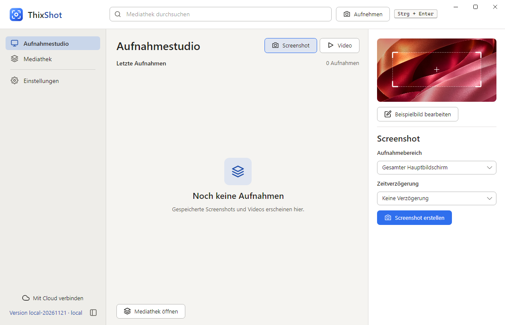
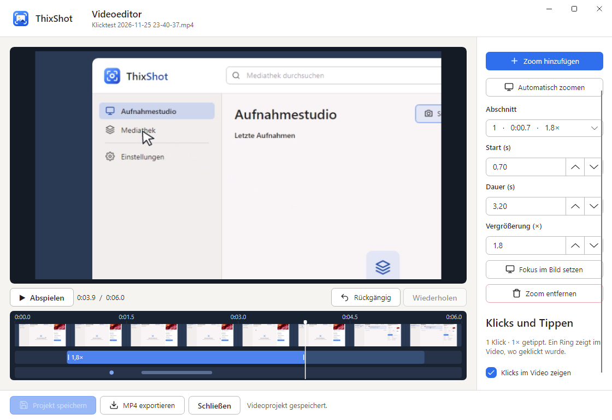

# ThixShot

ThixShot ist das Screenshot- und Aufnahmestudio für Windows und macOS von ThixApps.de. Screenshots lassen sich direkt zuschneiden und markieren. Bei Bildschirmvideos zoomt das Bild automatisch dorthin, wo gerade gearbeitet wird – zu Klicks und beim Tippen –, und ein Ring zeigt jeden Klick. Beides lässt sich nachträglich ändern.



## Installation

Die [Releases](https://github.com/Real-TTX/ThixShot/releases/latest) enthalten ein Windows-MSI für x64 sowie getrennte DMGs für Macs mit Apple Silicon und Intel. Unter Windows das MSI öffnen. Auf macOS die passende DMG öffnen und ThixShot nach „Programme“ ziehen. Die App bringt die .NET-Laufzeit mit.

Die Bildschirmaufnahme nutzt unter Windows 10/11 Media Foundation. Windows-N-Editionen benötigen das Media Feature Pack. Auf macOS 14 oder neuer benötigt ThixShot die Freigabe für Bildschirm- und Systemaudioaufnahme. Die Mac-Pakete tragen eine Ad-hoc-Signatur. Apple-Notarisierung und Windows-Publishersignatur stehen aus.

## Aufnahme und Mediathek

- **Bereitschaft** in der Titelleiste öffnet eine halbtransparente Leiste oben mittig am Bildschirm. Screenshot oder Video direkt dort starten. Während der Aufnahme erscheinen Dauer und Stopp. Am Griff lässt sich die Leiste verschieben. Im Menü lässt sich die Standardposition wiederherstellen. Das Monitorsymbol führt zurück ins Studio.
- **Screenshot erstellen** blendet ThixShot aus. Ziehe den gewünschten Bereich direkt auf dem Bildschirm auf. Beim Loslassen öffnet sich der Ausschnitt im Editor, mit **Esc** brichst du die Auswahl ab. „Gesamter Hauptbildschirm“ und ein Timer mit 3, 5 oder 10 Sekunden Vorlauf stehen im Studio und in den Optionen der Bereitschaftsleiste zur Wahl. Im Editor kannst du zuschneiden, markieren und das Bild kopieren, als PNG exportieren oder in der Mediathek speichern.
- **Video** zeichnet den Hauptbildschirm oder einen Ausschnitt mit bis zu 30 Bildern pro Sekunde in MP4/H.264 auf. Mauszeiger, Fokus-Zoom und Systemton lassen sich einzeln einstellen. Die Ausgabe passt in 1920 × 1080 Pixel und erhält das Seitenverhältnis. Während der Aufnahme merkt sich ThixShot Klicks und Tastenanschläge – nur den Zeitpunkt und die Stelle (Textcursor, sonst letzter Klick), nie welche Taste.
- **Fokus-Zoom** macht daraus Zooms: Was zeitlich zusammengehört, ist ein Zoom, der beim Tippen stehen bleibt. Geht die Arbeit an einer anderen Stelle weiter, schwenkt das Bild dorthin, statt heraus- und wieder hineinzuzoomen. Erst nach einer Pause von 2,5 Sekunden zoomt es heraus. Jeder Klick erscheint im Video als kurzer Ring.
- **Video bearbeiten** öffnet die Aufnahme mit Zoomspur und darunter der Spur für Klicks (Punkte) und Tippen (Balken). Den Abspielkopf auf die gewünschte Stelle setzen und „Zoom hinzufügen“ wählen. Ein Klick ins Bild bestimmt das Ziel. Zoomabschnitte können verschoben, an ihren Rändern gekürzt, verstärkt oder entfernt werden. „Automatisch zoomen“ setzt die Zooms neu aus Klicks und Tippen. „Klicks im Video zeigen“ schaltet die Ringe aus und ein. Ein Klick auf einen Punkt wählt den Klick, „Klick entfernen“ (Entf) nimmt ihn aus dem Video. Alles lässt sich rückgängig machen. „Projekt speichern“ behält die Einstellungen für spätere Bearbeitung. „MP4 exportieren“ rendert die aktuelle Fassung mit Ton. Die Zeitleiste bietet eine stumme Bildvorschau. Im Videomodus legt „Beispielvideo anlegen“ einen sechssekündigen Clip zum Ausprobieren an.
- **Mediathek** bietet Suche, Formatfilter und Sortierung. Aufnahmedetails öffnen, um Dateien umzubenennen, zu exportieren, zu löschen oder hochzuladen. Screenshots lassen sich in die Zwischenablage kopieren, Videos im Standardplayer abspielen. Die Dateien liegen im lokalen Anwendungsdatenordner unter `ThixShot/Media`.
- **Einstellungen** enthalten die Darstellung (System, Hell oder Dunkel), Autostart und Updates. Vollautomatische Updates sind optional. Titelleiste, einklappbare Seitenleiste und Dialoge verwenden wie ThixClip die gemeinsame MatDesktop-Oberfläche. Die Versionsnummer unten links öffnet „Über ThixShot“.
- **ThixCloud** koppelt das Gerät per Browsercode mit der eigenen Instanz. Manuell ausgewählte Dateien landen im persönlichen ThixDrive im Ordner **ThixShot**. Für MatCloud-Vertrag 1.4.0 liegt die erforderliche [Serverfreigabe für die App-ID shot](integrations/matcloud/README.md) bei.

Ab Version 0.2 bleibt das Originalvideo in der Mediathek erhalten. Die lokale Zoomspur liegt unter `Media/.edits`. Wiedergabe, Export und Cloud-Upload verwenden die gespeicherte Schnittfassung. Bei Aufnahmen aus Version 0.1 gehören die damaligen Zooms bereits zum Bild. Zusätzliche Zooms sind auch bei diesen Dateien möglich. Klicks und Tippen kennt ThixShot erst bei Aufnahmen, die nach der Einführung der Klickspur entstanden sind.




## Entwicklung

Benötigt werden .NET SDK 10 und auf macOS die Xcode Command Line Tools. Die Oberfläche verwendet Avalonia UI. Die macOS-Aufnahme basiert auf ScreenCaptureKit und AVFoundation, Windows verwendet GDI, Media Foundation und WASAPI.

```sh
dotnet build ThixShot.slnx
dotnet test tests/ThixShot.Tests
dotnet run --project src/ThixShot
```

Das Windows-MSI entsteht mit `./scripts/package-windows.ps1`. Auf einem Mac erstellt `bash scripts/package-macos.sh osx-arm64` die Apple-Silicon-Pakete, `osx-x64` die Intel-Pakete. Die Ausgaben liegen in `artifacts/packages/`.

| Build | Anzeige | Verteilung |
| --- | --- | --- |
| main | `<Major>.<Minor>.<Laufnummer>-<yyyyMMdd>` | GitHub Release und Release-Updatekanal |
| dev | `nightly-<Laufnummer>-<yyyyMMdd>` | Nightly-Updatekanal |
| Weitere Branches, Pull Requests, lokaler Build | `local-<yyyyMMdd>` | CI-Artefakte bzw. lokales Paket |

GitHub Actions prüft Oberfläche und Bildbearbeitung, testet die nativen Videoencoder mit synthetischem Material und baut die drei Installer. Die beiden Updatekanäle liefern jeweils ein Manifest mit Buildnummer und SHA-256-Prüfsummen.
